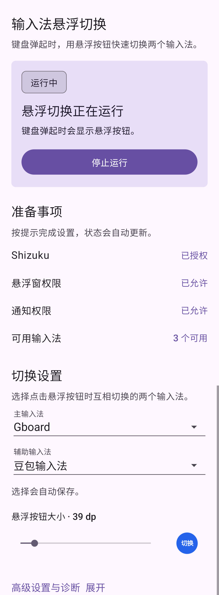
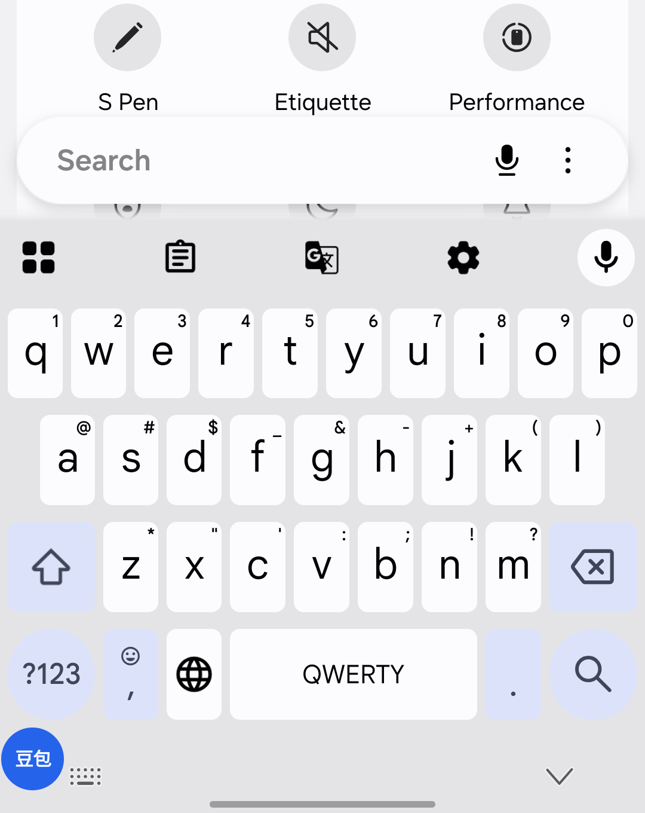
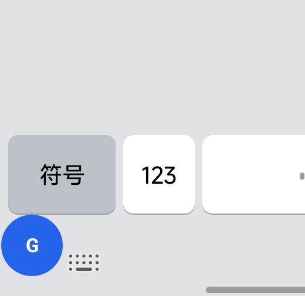

# 输入法悬浮切换

键盘弹起时显示一个可拖动的悬浮按钮，点击它在两个已启用输入法之间切换。按钮大小可调，切回输入法时会尝试恢复该输入法上次使用的语言或布局。

## 界面



配置页显示 Shizuku、悬浮窗、通知权限和可用输入法状态，并可以选择两个输入法。



键盘弹起后，悬浮按钮会显示在屏幕上。



按钮上的文字会随目标输入法变化。

## 使用条件

- Android 12 或更高版本（API 31）。
- 已启动 [Shizuku](https://shizuku.rikka.app/)，并已授予本应用权限。
- 系统中至少启用两个不同的输入法。
- 已授予悬浮窗权限。
- Android 13 或更高版本已授予通知权限。

应用本身不需要 Root，也不需要启用无障碍服务。没有 Root 时，可以使用无线调试或 ADB 启动 Shizuku。

## 安装

项目当前提供源码构建方式。用 Android Studio 打开项目根目录，使用 JDK 17 和 Android SDK 36。也可以在项目根目录执行：

```bash
gradle --no-daemon :app:assembleDebug
```

生成的 APK 位于 `app/build/outputs/apk/debug/app-debug.apk`。安装到已连接的设备：

```bash
adb install -r app/build/outputs/apk/debug/app-debug.apk
```

## 配置

1. 启动 Shizuku。
2. 打开本应用，点击请求 Shizuku 授权并完成授权。
3. 按应用提示授予悬浮窗权限和通知权限。
4. 在系统设置中启用要使用的两个输入法。
5. 在本应用的切换设置中选择主输入法和辅助输入法。两个输入法必须不同，选择会自动保存。
6. 点击启动监测。
7. 打开任意文本输入框。键盘弹起后，点击悬浮按钮切换输入法；拖动按钮可以调整位置。

应用会在通知中显示监测状态，也可以从通知中暂停或停止监测。

## 键盘识别失败时

打开高级设置与诊断，启用“键盘识别失败时保持按钮显示”。启用后按钮会保持显示，不再根据键盘状态自动隐藏。这个选项适合输入法状态无法被当前系统版本正确识别的设备。

## 权限和隐私

- Shizuku 用于读取输入法状态和执行用户点击的输入法切换。
- 悬浮窗权限用于显示可拖动的切换按钮。
- 通知权限用于显示前台监测服务的状态。
- 应用只在本地保存两个输入法 ID、上次使用的 subtype、按钮大小和位置，以及手动常显开关。
- 最近的采样统计和诊断文本只保存在内存中，应用退出后丢弃；原始系统 dump 不写入文件。
- 应用不声明网络权限，不接入广告、统计或云服务。
- 应用不读取其他应用的输入内容、剪贴板、通知内容、麦克风或前台应用内容，也不使用截图、OCR 和无障碍服务。

## 已知限制

- 运行监测期间需要保持 Shizuku 可用。Shizuku 停止、授权撤回或连接断开时，按钮会隐藏。
- 自动显示和隐藏依赖系统提供的输入法状态。在不同 Android 版本和厂商系统上，状态字段可能不同。
- Samsung One UI 可能把悬浮窗放在输入法窗口下方。按钮默认位于应用内容区域附近，可以拖动到合适位置。
- 目标输入法被禁用或卸载后不会执行切换，需要重新选择可用输入法。

更多兼容性记录见 [COMPATIBILITY.md](COMPATIBILITY.md)。

## 开发和测试

运行单元测试并构建 Debug APK：

```bash
gradle --no-daemon :app:testDebugUnitTest :app:assembleDebug
```
